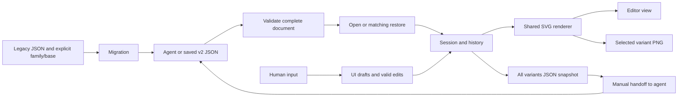

# Purpose and minimal design

PR #1 replaces figure-specific editing HTML with one offline app and separate diagram JSON.
Its useful result is a repeatable loop: an agent proposes a figure, a person adjusts it, the agent changes the supplied JSON, and the person continues in the same app.
Scientific meaning, structural proposals and final Typst production remain with the person and agent.
Sources of requirements are [PR #1](https://github.com/ryo-ARAKI/schemock/pull/1), [dotfiles-public Issue #37](https://github.com/ryo-ARAKI/dotfiles-public/issues/37), and the [v2 contract](data-format-v2.md).

## Indispensable constraints

- Open one self-contained HTML in desktop Chrome using file://, with separate arbitrary diagram JSON, without a server, network, account or user package installation.
- Support the existing two families and their direct editing capabilities; preserve full numeric precision, text, newlines, colors and every curve control point.
- Distinguish app/format versions, figure/revision/variant/object identity, immutable initial states and editable current states.
- Validate complete input before adoption; restore only a matching figure, revision and reset basis. Keep work on invalid input, cancellation, failed saves and stale asynchronous results.
- Keep all variants in JSON, the selected composition in PNG, tab-local chronological history, native field undo and incomplete input drafts.
- Migrate both legacy formats explicitly without guessing a missing reset basis or overwriting originals.
- Use one renderer for the editor, PNG output and static previews. Keep data inert and handoff manual.

These constraints explain mechanisms that may otherwise appear redundant: open versus restore, initial versus current, field drafts versus valid data, and completed native writes versus requested downloads.
They protect different user decisions and failure cases and remain separate.

## Responsibilities and dependencies

| Files | Responsibility and actual consumers |
| --- | --- |
| `src/document.js`, `src/colors.js` | Runtime validation, restoration identity, surviving constraints, value equality and fixed Typst RGB rules. Used by session, rendering, migration, preview and tests. |
| `src/session.js` | Accepted document, selection, history, dirty fingerprint and read-generation tokens. No DOM or file APIs. Used by the UI and unit tests. |
| `src/app.js`, `src/forms.js` | UI orchestration and draft text, composition, drag and asynchronous operation state; precise numeric/point input. |
| `src/diagrams/*.js` | Family-specific geometry, dependency deletion and path operations. They depend only on document rules; document rules do not depend on geometry or the DOM. |
| `src/render.js` | SVG construction using safe text and fixed color rules. Uses the two geometry modules; consumed by the UI and PNG export. |
| `src/io.js` | Safe output names, native save/download boundaries and SVG-to-PNG conversion. Uses the renderer, never changes the session. |
| `src/migrate.js` | Explicit v1-to-v2 conversion and JSON-only extraction from known legacy HTML. Uses the document contract. |
| `src/index.html`, `src/styles.css` | Shared shell, controls and presentation, with no embedded figure data. |
| `scripts/build.mjs`, `scripts/archive.mjs` | Bundle local modules and package deterministic HTML/data/checksums using Node built-ins. No runtime dependency resolution. |
| `scripts/preview.mjs`, `scripts/verify-release.mjs` | Drive the built app in offline Chrome for PNG previews and isolated release checks. Reuse the development-only Chrome transport in `tests/browser/chrome.mjs`. |
| `schemas/`, `examples/`, `tests/fixtures/` | External format description, usable diagrams, complete handoff stages and migration/invalid inputs. No app dependence on specific example IDs. |
| `tests/unit/`, `tests/browser/`, `.github/workflows/ci.yml` | Pure contracts, real Chrome UI/download/failure/handoff behavior, and CI execution. |

The browser bundle contains no Node or test transport code.
The schemas describe allowed JSON shape; runtime checks also enforce identity, references and retained structure.
Removing either the portable schemas or runtime checks would remove part of the external contract.

## Data flow

The session commits only validated isolated documents; mutations work on a draft, and committed documents are treated as read-only within the app.
History can retain a committed document without copying it before every edit.
Save uses a separate validated snapshot so editing and document switches during asynchronous writes cannot change the output or incorrectly clear the new document's dirty state.
Input text that cannot yet become valid data stays in the UI's variant/object/field drafts and never enters exported JSON.
The read generation tracks valid document changes, the UI epoch also tracks unfinished input and selection operations, and the document serial distinguishes a newly opened document from the one being saved.
The browser tests exercise stale reads, edits during saves and document switches during saves; these counters protect distinct cases.

## Evidence and ordered simplifications

The 2026-11-01 review inspected all source modules, scripts, schemas, tests and documentation against the PR/issue requirements.
Usage evidence comes from the call sites, examples, complete handoff exercises and real Chrome tests; there is no production telemetry establishing broader usage.
The main examples have two node/edge variants and three spectrum variants, with 42 and 83 current objects respectively.
The large spectrum example also exercises long point lists; total file line count is not evidence of an architectural problem.

1. **Delete redundancy:** the four invalid fixtures were complete example copies totaling 606,622 bytes, although their sole consumer checked one duplicate-ID or unknown-field error path. Replace them with standalone minimal JSON totaling 4,644 bytes. Keep the same file names, families and rejection paths, and validate each after repairing only its stated defect. Original examples, complete migration cases and human/agent handoff stages retain their original data.
2. **Simplify ownership:** deletion now uses the validator's surviving-constraints rule. Remove unused UI imports and the Chrome transport's unused download inventory and empty listener. Keep the existing focused modules and whole-document history; patch-based history, registries and a general graph model would add machinery without a demonstrated workflow need.
3. **Optimize measured edit work:** compare JSON values recursively instead of sorting and rebuilding every object before stringification. Keep object-key-order independence and array order. Reuse the committed pre-edit document as the history snapshot, and adopt the isolated clone already returned by validation. This removes one full clone per edit and prevents a retained mutation draft from subsequently changing committed state.
4. **Automate contracts where useful:** extend existing unit coverage for invalid fixtures, mutation isolation, rejected-edit atomicity and reordered-key restoration. Keep the existing offline browser suite, build, preview and release commands; another orchestration layer would duplicate them.

No general UI rewrite, scene index, incremental renderer, format revision or migration rewrite is justified by this review.
Keep the narrow local module bundler and deterministic regular-file archive writer: replacing them would introduce a build dependency or system-tool requirement without removing a runtime requirement.
The finite coordinate bound does not promise that every accepted frame size fits Chrome's PNG canvas limits; export failures remain explicit and preserve the document.
Timing improvements describe session edits on the supplied examples, not end-to-end browser performance or a bound for arbitrarily large documents.

## Completion boundary

For this PR, require passing pure-contract and real offline Chrome tests, unchanged rendered diagrams, deterministic release bytes and isolated HTML-plus-JSON verification.
The [release checklist](releasing.md) remains authoritative for actual OS IME/native dialogs, publication, public-download verification and the downstream skill switch.
Those external checkpoints are not established by local automation, and this PR alone does not complete dotfiles-public Issue #37.
